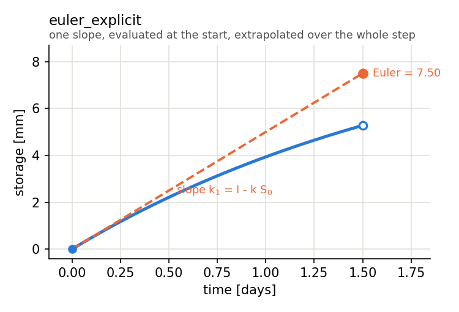
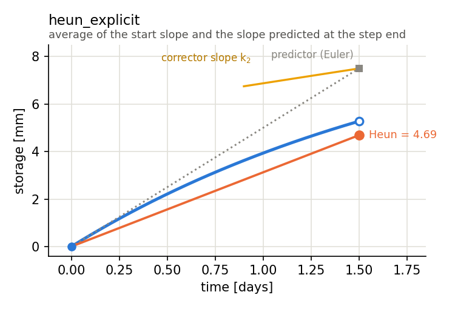
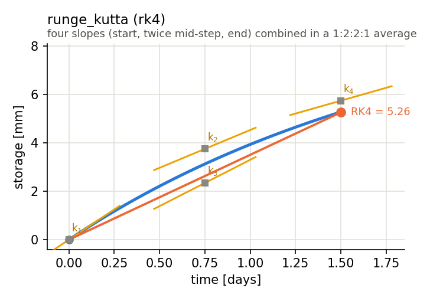
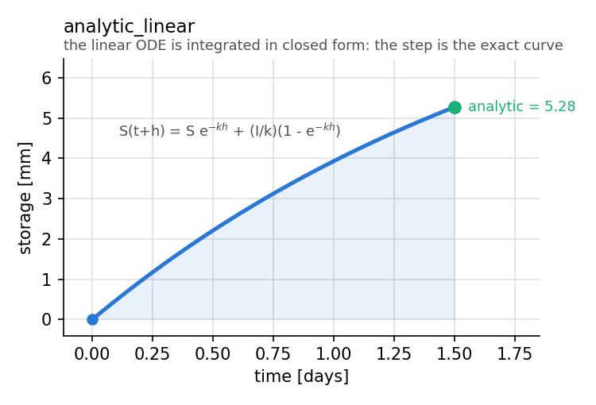
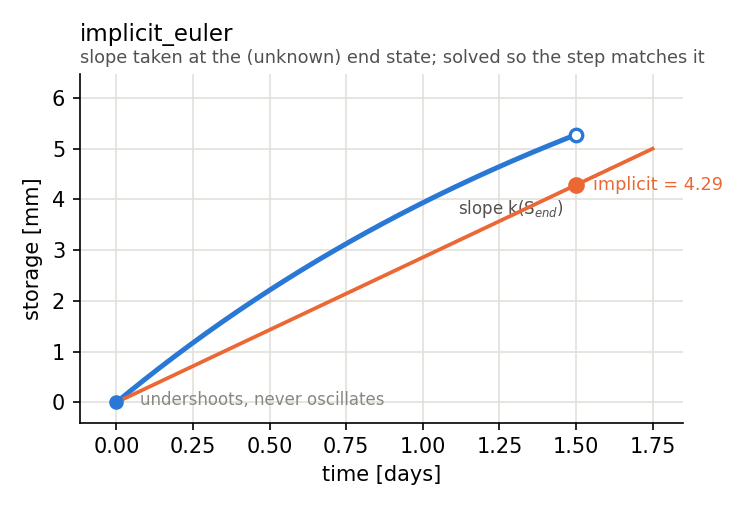
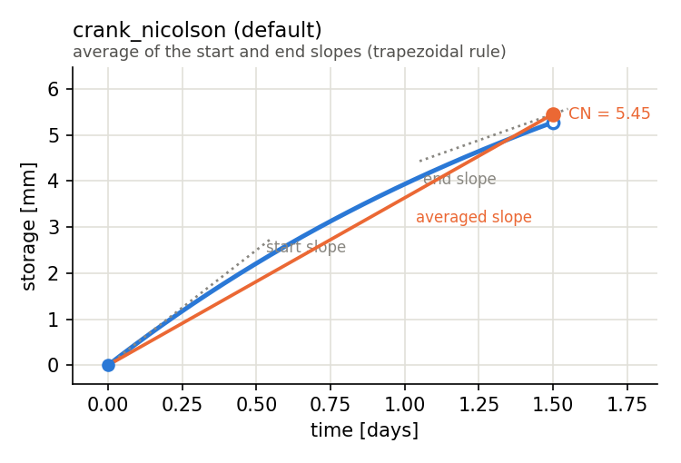
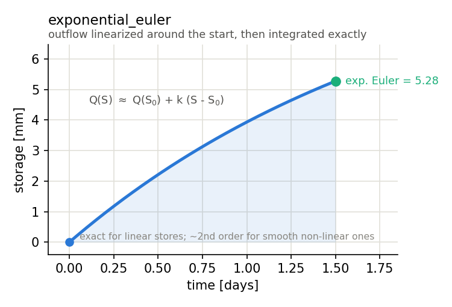
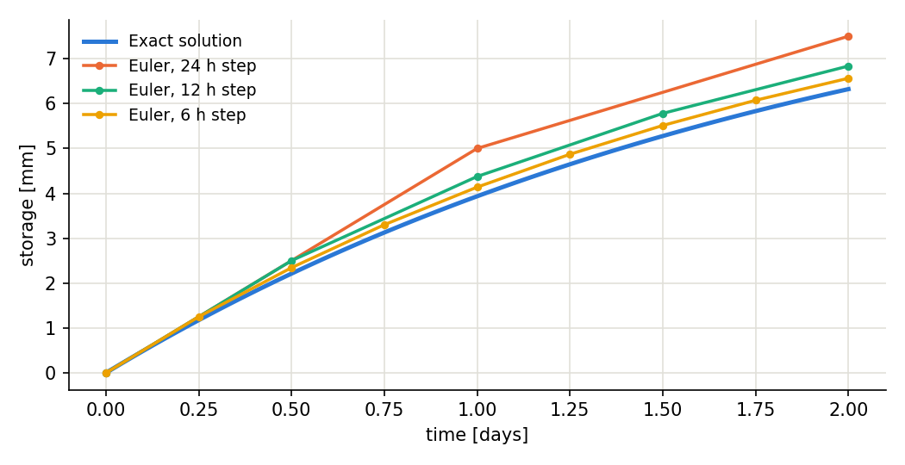
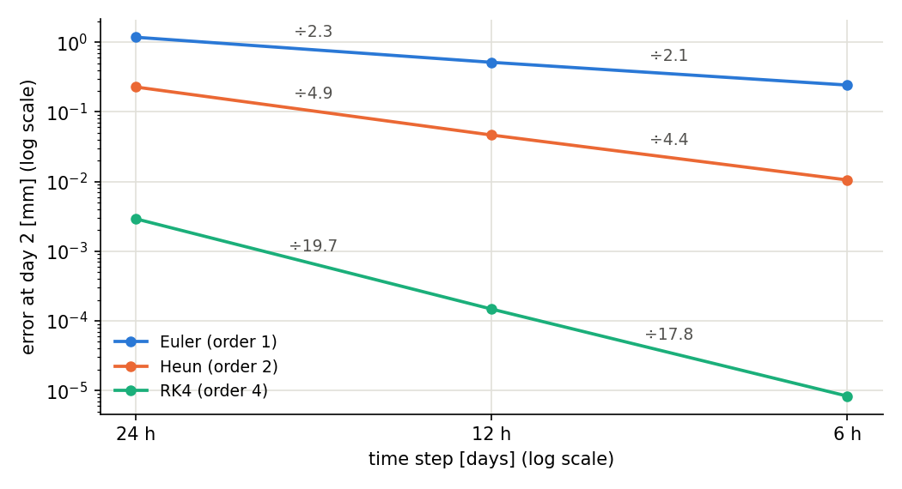
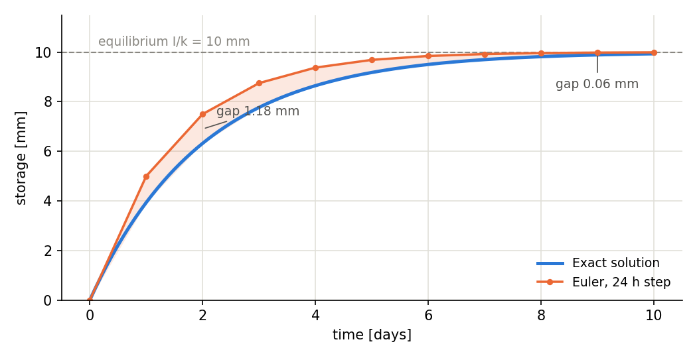

.. _solvers:

Numerical solvers
=================

The reservoirs of a model structure (soil storages, groundwater reservoirs,
routing stores) form a system of ordinary differential equations (ODEs) of the
form :math:`\mathrm{d}S/\mathrm{d}t = I - Q(S)`, where :math:`S` is the storage
content, :math:`I` the inflow and :math:`Q(S)` the content-dependent outflow.
The numerical solver integrates this system over each time step. The solver is
selected at model instantiation:

.. code-block:: python

   socont = models.Socont(solver="exponential_euler")  # the default

Available solvers
-----------------

.. list-table::
   :header-rows: 1
   :widths: 22 12 14 52

   * - Name
     - Order
     - RHS eval. / step
     - Properties
   * - ``euler_explicit``
     - 1
     - 1
     - Fastest; least accurate; can become unstable for fast-reacting
       reservoirs (see :ref:`stability <solver-stability>`).
   * - ``heun_explicit``
     - 2
     - 2
     - Good accuracy/cost compromise while the response factors stay small;
       conditionally stable, and loses accuracy as :math:`k\,h` approaches 1
       (see :ref:`choosing a solver <choosing-a-solver>`).
   * - ``runge_kutta`` (or ``rk4``)
     - 4
     - 4
     - Most accurate of the explicit schemes for smooth dynamics; the extra
       cost rarely pays off when thresholds or storage limits are active.
   * - ``analytic_linear`` (or ``analytic``)
     - exact
     - 1
     - Integrates linear reservoirs exactly (see
       :ref:`below <analytic-solver>`); unconditionally stable; no transit
       lag through reservoir cascades.
   * - ``implicit_euler`` (or ``euler_implicit``)
     - 1
     - iterative
     - Backward Euler (see :ref:`below <implicit-solver>`); unconditionally
       stable for any process, including non-linear ones; no transit lag.
   * - ``crank_nicolson`` (or ``trapezoidal``)
     - 2
     - iterative
     - Implicit trapezoidal (see :ref:`below <crank-nicolson-solver>`);
       second-order accurate and unconditionally stable for any process; no
       transit lag.
   * - ``exponential_euler`` — **default**
     - 2 (exact for linear)
     - 3
     - Analytic integration of the per-step linearized system (see
       :ref:`below <exponential-euler-solver>`); unconditionally stable; no
       transit lag.

The first three are classic explicit Runge–Kutta schemes
(:ref:`illustrated below <explicit-solvers>`): they evaluate the outflow rates
at one or more intermediate states and advance all the solved reservoirs
together as one coupled system. The remaining solvers follow a different,
sequential strategy described in the sections that follow.

To show how each scheme works, the sections below illustrate it on a single
step of the same linear reservoir (:math:`k = 0.5\,\mathrm{d^{-1}}`, initially
empty, constant inflow :math:`I = 5\ \mathrm{mm/d}`), with the step taken
deliberately large (:math:`h = 1.5\ \mathrm{d}`, so :math:`k\,h = 0.75`) to
make the schemes' behaviour visible. In every panel the blue curve is the
exact solution and the filled marker is where the scheme places the reservoir
at the end of the step.

How a time step is computed
---------------------------

Within each time step, the computation proceeds in two phases:

1. **Direct phase.** The surface elements (land covers, snowpacks, glaciers —
   in general everything marked as computed directly) are processed
   sequentially, in the order of their declaration. Their outputs (melt,
   infiltration, runoff) are booked as inputs to the reservoirs below.
2. **Solver phase.** The reservoirs are then integrated over the time step by
   the selected solver, receiving the surface outputs of the current step.

This split keeps threshold-type surface processes (rain/snow partition, melt
switching on and off) out of the ODE system, which the solver can then treat
as smooth dynamics.

.. _explicit-solvers:

The explicit schemes (Euler, Heun, RK4)
---------------------------------------

The explicit Runge–Kutta schemes build the step from outflow rates ("slopes")
evaluated at one or more trial states, then advance all reservoirs together.
They need no iteration, but are only conditionally stable and lose accuracy
where thresholds or storage limits activate mid-step.

   **euler_explicit** — a single slope, evaluated at the start of the step, is
   extrapolated across the whole step. Because the outflow rate is frozen at
   its start-of-step value (here still too low, as the store has barely
   filled), the reservoir overshoots the exact solution. First-order accurate;
   the simplest and cheapest scheme.

   **heun_explicit** — a predictor first takes an Euler step to estimate the
   end state; a second slope is evaluated there, and the step advances along
   the *average* of the two slopes. Averaging the start and predicted-end
   rates cancels the leading Euler error, giving second-order accuracy at
   twice the cost.

   **runge_kutta (rk4)** — four slopes (one at the start, two probing the
   mid-step state, one at the end) are combined in a 1:2:2:1 weighted average.
   The resulting step tracks the exact curve closely: fourth-order accurate for
   smooth dynamics, at four rate evaluations per step.

.. _analytic-solver:

The analytic solver
-------------------

For a reservoir with a linear outflow (``outflow:linear``,
:math:`Q = k\,S`) and an inflow held constant over the step, the ODE has a
closed-form solution:

.. math::

   S(t+h) = S(t)\,e^{-kh} + \frac{I}{k}\left(1 - e^{-kh}\right),

with the outflow volume following from mass balance,
:math:`V_\mathrm{out} = I\,h - \left(S(t+h) - S(t)\right)`.
The ``analytic_linear`` solver uses this solution directly. It processes the
reservoirs one by one in declaration order (upstream before downstream); each
reservoir receives the upstream outflow of the *same* step as a constant
inflow rate. Processes that are not linear in the content (e.g. evapotranspiration)
are accounted for with their rate evaluated at the start of the step.

   **analytic_linear** — for a linear store the step follows the exact
   exponential, so the scheme's end-of-step value lies exactly on the true
   curve, at any step size and without transit lag.

This gives the analytic solver three properties the explicit schemes lack:

* **Exactness** for linear reservoirs, at any time step — the results do not
  change when the time step is refined.
* **Unconditional stability** — fast-reacting reservoirs (large
  :math:`k\,h`) cannot destabilize it.
* **No transit lag** — water entering an empty reservoir contributes to its
  outflow within the same step, and a cascade of reservoirs responds within
  one step. With explicit schemes, the outflow of a reservoir only reacts to
  inflows one (Euler) or a fraction of a step later; a rainfall pulse
  therefore needs several steps to traverse a cascade.

Two points to note:

* A reservoir with a maximum capacity that can actually be reached must route
  its excess through an overflow process: the sequential solvers process
  bricks one after another and cannot reduce an inflow an upstream brick has
  already delivered, so an overflowing capped store without an overflow would
  lose water. Stores whose capacity acts only as a process parameter with a
  self-limiting inflow (e.g. the GR4J production store, whose infiltration
  tends to zero as the store fills) never reach the limit and need no overflow.
* Only outflows declared as linear are integrated exactly; other processes on
  the same reservoir are approximated with their start-of-step rate. For
  strongly non-linear reservoirs (e.g. the Socont quick-runoff store), the
  analytic solver degrades to a first-order approximation for that store.

.. _implicit-solver:

The implicit Euler solver
-------------------------

The ``implicit_euler`` solver shares the sequential structure of the analytic
solver (same processing order, same inflow treatment, same handling of
capacity-limited stores) but advances each reservoir by solving the implicit
equation

.. math::

   S(t+h) = S(t) + h \left(I - Q\!\left(S(t+h)\right)\right),

where :math:`Q(S)` is the total outflow of the reservoir's processes evaluated
at the **end-of-step** content. The scalar equation is solved by a bracketed
iteration, which is robust because the total outflow does not decrease with the
content, so the residual is monotonic and its root is bracketed from the start.

   **implicit_euler** — the outflow slope is evaluated at the *end-of-step*
   content, found by the bracketed iteration so that advancing along that slope
   lands exactly on it. The store undershoots the exact solution but can never
   overshoot or oscillate, whatever the step size.

Because every process — including non-linear ones such as evapotranspiration —
is evaluated at the end-of-step state, the scheme is **unconditionally stable
for any process formulation**. Its accuracy is first order, like explicit
Euler, but it undershoots where explicit Euler overshoots and never
oscillates: this makes it the most robust choice for very stiff reservoirs,
where the second-order Crank-Nicolson solver can show a decaying oscillation.

.. _crank-nicolson-solver:

The Crank-Nicolson solver
-------------------------

The ``crank_nicolson`` solver shares the sequential, iterative structure of the
implicit Euler solver but advances each reservoir with the implicit trapezoidal
rule,

.. math::

   S(t+h) = S(t) + h \left(I - \frac{Q\!\left(S(t)\right) +
   Q\!\left(S(t+h)\right)}{2}\right),

applying to each process the average of its start- and end-of-step rates.

   **crank_nicolson** — the step advances along the average of the start- and
   end-of-step slopes (the end state again found by the bracketed iteration).
   Averaging the two slopes recovers second-order accuracy, so the step stays
   close to the exact curve while remaining unconditionally stable.

This combines **second-order accuracy** (like Heun) with **unconditional
stability** (like implicit Euler) for any process formulation. One caveat: the trapezoidal rule is *A-stable but not
L-stable*. These two properties describe how a scheme handles a stiff
(fast-decaying) reservoir, and differ in a way that matters here:

* **A-stable** means the solution can never blow up, whatever the time step:
  for a linear reservoir the step-to-step amplification factor of
  Crank-Nicolson, :math:`(1 - k\,h/2)\,/\,(1 + k\,h/2)`, stays below one in
  magnitude for every :math:`k\,h`. Explicit Euler is *not* A-stable — its
  factor :math:`1 - k\,h` exceeds one once :math:`k\,h > 2`, which is why it
  diverges for fast reservoirs.
* **L-stable** is the stronger property that this factor also tends to *zero*
  as :math:`k\,h \to \infty`, so a very stiff mode is damped away within a
  single step. Implicit Euler is L-stable (its factor :math:`1/(1 + k\,h)`
  goes to zero); Crank-Nicolson is not, because its factor instead tends to
  :math:`-1`.

A factor approaching :math:`-1` means a stiff mode is not damped but flips
sign each step and decays only slowly. In practice, for very stiff reservoirs
(:math:`k\,h \gg 1`) Crank-Nicolson can therefore show a decaying oscillation
(ringing) around the solution where the L-stable ``implicit_euler`` approaches
it monotonically. Both remain bounded and converge; but if a calibration
explores such extreme response factors and the oscillation is undesirable,
prefer ``implicit_euler``.

.. _exponential-euler-solver:

The exponential Euler solver
----------------------------

The ``exponential_euler`` solver generalizes the analytic solver to non-linear
processes. Each reservoir's total outflow is linearized around the
start-of-step content, :math:`Q(S) \approx Q(S_0) + k\,(S - S_0)` (with
:math:`k` obtained by finite difference), and the linearized equation is
integrated exactly over the step. For linear reservoirs the linearization *is*
the reservoir, so the solution is exact, as with ``analytic_linear``; for
smooth non-linear processes the scheme is second-order accurate. It is
unconditionally stable and free of transit lag.

   **exponential_euler** — the outflow is replaced by its linear tangent at the
   start of the step, and that linearized equation is integrated exactly (as in
   the analytic solver). For a linear store the tangent *is* the outflow, so the
   step is exact; for a smoothly non-linear store it is second-order accurate.

Accuracy and the time step
--------------------------

Every discrete scheme carries a *discretization error* that shrinks as a power
of the time step :math:`h`:

.. math::

   \text{error} \approx C\,h^p,

where :math:`p` is the **order** of the scheme. Halving the time step divides
the error by :math:`2^p`: by ~2 for Euler, ~4 for Heun and ~16 for RK4. The
following figures illustrate this on a linear reservoir
(:math:`k = 0.5\,\mathrm{d^{-1}}`, initially empty) filling under a constant
rain of 5 mm/d — a problem with a known exact solution.

   The exact solution and the explicit Euler approximation at 24 h, 12 h and
   6 h steps. Each step holds the start-of-step outflow constant, so coarser
   steps overshoot the exact curve; each halving of the step roughly halves
   the gap (1.18 → 0.51 → 0.24 mm at day 2) — the signature of a first-order
   scheme.

   The day-2 error against the step size on log–log axes, where
   :math:`\text{error} \approx C\,h^p` appears as a straight line of slope
   :math:`p`. The printed factors are the measured error ratios per halving:
   ~2 for Euler, ~4 for Heun, ~16 for RK4. The ratios sit slightly above the
   nominal :math:`2^p` at coarse steps (where higher-order terms still
   contribute) and approach it as the step shrinks.

Two practical consequences:

* **Discretization errors live in the transients.** They are largest while
  the storages are rising or falling quickly — that is, around flood peaks —
  and vanish near equilibrium, where inflow balances outflow and every scheme
  finds the same steady state (see below). If low-flow periods look right but
  peaks are damped or delayed, the time step or the solver order may be the
  cause.
* **A higher order only pays off for smooth dynamics.** When storage limits
  or thresholds are active during a step, all schemes degrade locally; RK4's
  fourth order is only realized away from such events.

   The same reservoir over ten days: the exact solution and the Euler
   approximation both converge to the equilibrium
   :math:`I/k = 10` mm, and the gap between them fades from 1.18 mm at day 2
   to 0.06 mm at day 10. Discretization errors matter during the transient,
   not at steady state.

.. _solver-stability:

Stability
---------

Explicit schemes are only conditionally stable: for a linear reservoir,
explicit Euler oscillates when :math:`k\,h > 1` and diverges when
:math:`k\,h > 2`. With daily steps, this concerns fast-reacting reservoirs
with response factors approaching :math:`1\,\mathrm{d^{-1}}` and beyond. If a
calibration explores such values, prefer ``analytic_linear`` or
``implicit_euler`` (both unconditionally stable), or reduce the time step.

.. _choosing-a-solver:

Choosing a solver
-----------------

The two tables below give the orders of magnitude to weigh, both measured on
the same setup: the Socont model of ``examples/basics/sitter_project.yaml``
(the Sitter catchment, 35 hydro units, 40 years), with the parameters of that
file. Its reservoirs react fast (response factors of 0.8 to
:math:`1\,\mathrm{d^{-1}}`, so :math:`k\,h` is close to 1 at a daily step),
which is where the schemes differ most.

The accuracy is measured against a reference solution of the same model, not
against the observed discharge: the ``runge_kutta`` scheme at a 15-minute step,
with the daily forcing spread evenly over the day (``crank_nicolson`` at the
same step agrees with it to :math:`1 - \mathrm{NSE} = 3 \cdot 10^{-8}`). The
scores therefore measure the discretization error alone, and a perfect scheme
would reach 1 whatever the quality of the model. For context, the reference
itself reaches NSE = 0.70 and KGE = 0.81 against the observed discharge.

At a daily step:

.. list-table::
   :header-rows: 1
   :widths: 26 14 12 12 16 20

   * - Solver
     - Run time
     - NSE
     - KGE
     - Peak error
     - Largest error
   * - ``euler_explicit``
     - 1.0
     - 0.576
     - 0.676
     - −4.7 %
     - 77 %
   * - ``analytic_linear``
     - 1.1
     - 0.994
     - 0.996
     - +0.1 %
     - 2.9 %
   * - ``heun_explicit``
     - 1.6
     - 0.954
     - 0.974
     - +4.8 %
     - 20 %
   * - ``exponential_euler`` (default)
     - 2.1
     - 0.999
     - 0.997
     - −0.5 %
     - 4.2 %
   * - ``runge_kutta``
     - 2.9
     - 0.999
     - 0.993
     - +0.2 %
     - 1.6 %
   * - ``crank_nicolson``
     - 4.0
     - 0.997
     - 0.989
     - −1.1 %
     - 5.9 %
   * - ``implicit_euler``
     - 4.4
     - 0.933
     - 0.965
     - +6.0 %
     - 24 %

The run time is that of the integration alone (the parameters and the forcing
already in place), relative to ``euler_explicit``, which takes 0.24 s for the 40
years. The peak error is taken on the largest peak of the reference, and the
largest error is the largest daily difference over the 40 years, both relative
to that peak.

NSE / KGE against the same reference as the time step shrinks:

.. list-table::
   :header-rows: 1
   :widths: 26 15 15 15 15 15

   * - Solver
     - 24 h
     - 12 h
     - 6 h
     - 3 h
     - 1 h
   * - ``euler_explicit``
     - 0.58 / 0.68
     - 0.95 / 0.93
     - 0.99 / 0.97
     - 1.00 / 0.99
     - 1.00 / 1.00
   * - ``analytic_linear``
     - 0.99 / 1.00
     - 1.00 / 1.00
     - 1.00 / 1.00
     - 1.00 / 1.00
     - 1.00 / 1.00
   * - ``heun_explicit``
     - 0.95 / 0.97
     - 1.00 / 0.99
     - 1.00 / 1.00
     - 1.00 / 1.00
     - 1.00 / 1.00
   * - ``exponential_euler``
     - 1.00 / 1.00
     - 1.00 / 1.00
     - 1.00 / 1.00
     - 1.00 / 1.00
     - 1.00 / 1.00
   * - ``runge_kutta``
     - 1.00 / 0.99
     - 1.00 / 1.00
     - 1.00 / 1.00
     - 1.00 / 1.00
     - 1.00 / 1.00
   * - ``crank_nicolson``
     - 1.00 / 0.99
     - 1.00 / 1.00
     - 1.00 / 1.00
     - 1.00 / 1.00
     - 1.00 / 1.00
   * - ``implicit_euler``
     - 0.93 / 0.97
     - 0.98 / 0.98
     - 0.99 / 0.99
     - 1.00 / 0.99
     - 1.00 / 1.00

The script that produces these tables is ``doc/images/benchmark_solvers.py``
in the documentation repository.

What this says in practice:

* **With fast reservoirs at a daily step, the schemes differ widely.**
  ``euler_explicit`` breaks down (errors up to 77 % of the peak).
  ``heun_explicit`` and ``implicit_euler`` stay around 0.93 to 0.95, but
  misplace part of each flood (errors up to 20 to 24 % of the peak). The four
  other schemes stay at 0.99 or above.
* **The exponential and analytic schemes give the most accuracy for the
  cost.** ``analytic_linear`` reaches 0.994 for barely more than the cost of
  explicit Euler, and ``exponential_euler`` 0.999 for twice that cost, which
  makes it the default: as accurate as the most accurate schemes, cheaper than
  them, and unconditionally stable.
  ``analytic_linear`` does well here because this Socont structure is drained
  mostly by linear outflows, which it integrates exactly. It is not always the
  best option: every other process on a store (evapotranspiration, percolation,
  non-linear runoff) is held at its start-of-step rate, which is explicit Euler
  for that part. These processes are then first order and only conditionally
  stable, and they do not react within the step to water reaching a store that
  was empty at its start. On a structure with significant non-linear processes
  (the HBV or GR soil functions, the Socont kinematic runoff), prefer
  ``exponential_euler``, which linearizes every process and keeps the exactness
  for the linear ones.
* **The Crank-Nicolson and Runge-Kutta schemes are as accurate, at three to
  four times the cost.**
* **Implicit Euler is the most expensive and, being first order, the least
  accurate of the implicit schemes.** Reach for it when a very stiff reservoir
  makes the trapezoidal rule ring (see :ref:`above <crank-nicolson-solver>`),
  not for accuracy or speed.
* **Reducing the time step is the other lever.** At 12 h, every scheme but
  explicit Euler is at about 0.98 or above, and at 6 h every scheme is at 0.97
  or above; a sub-daily model is far less sensitive to the choice of scheme.
* **Calibrate with the solver you run with.** Across the schemes, the NSE
  against the observed discharge ranges from 0.57 to 0.72 for the same
  parameters at a daily step: a calibration absorbs part of the error of its
  scheme into the fitted parameters, which do not carry over unchanged to
  another scheme.

Verification
------------

The behaviour documented here is enforced by the test suite of the
computational core: convergence tests run the schemes at 24 h, 12 h and 6 h
steps against the analytic solution and assert the error ratios above (a
scheme whose implementation silently lost its order would fail them), and the
analytic solver is verified against the closed-form solution and for exact
mass-balance closure.
